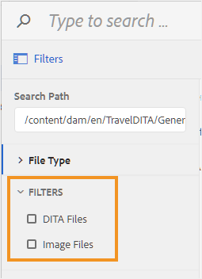

# Configure filters for file browse dialog

While working in the Editor, you need to use the file browse dialog to insert elements like image, reference, or key reference. The default file browse dialog does not offer any file filtering option. You can add your own filters that would allow you to access the required files easily and quickly.

The following tabs provide instructions to add your custom file filtering options to the file browse dialog based on your Experience Manager Guides setup: Cloud Service or On-Premise.

>[!BEGINTABS]

>[!TAB Cloud Service]

1.  To download the UI configuration file log into Adobe Experience Manager as an administrator.

1.  Click on the Adobe Experience Manager link at the top and choose **Tools**.
1.  Select **Guides** from the list of tools and click the **Folder Profiles**.
1.  Click on the **Global Profile** tile.
1.  Select the **XML Editor Configuration** tab and click **Edit** icon on the top
1.  Click the **Download** icon to download the ui\_config.json file on your local system. You can then make changes to the file and then upload the same.
1.  In the `ui_config.json` file, add the definition of the filters you want to add.

    The following code snippet shows how to add two filtering options — DITA Files and Image Files.

    ```
    "browseFilters": [
                        {
                        "title": "DITA Files",
                        "property": "jcr:content/metadata/dita_class",
                        "operation": "exists"
                        },
                        {
                        "title": "Image Files",
                        "property": "jcr:content/metadata/dc:format",
                        "value": [
                        "image/jpeg",
                        "image/gif",
                        "image/png"
                        ]
                        }
                        ]
    ```

    In the above code snippet, the first filter is for DITA Files. The filter definition takes the following parameters:

    title
    :   The display name of the filter. This title appears as the filtering option in the file browse dialog.

    property
    :   The property to match in the file's metadata. For example, to allow only those files that have the `dita_class` metadata in their property, the property filter takes " `jcr:content/metadata/dita_class`" as its value.

    operation
    :   Specify " `exists`" to match for existence of the value specified in the property parameter.

    The second filter is for Image Files. The parameters are similar to the first filter except the `value` parameter. The `value` parameter takes an array of image types as its value. All file types specified in the value parameter are searched for and shown in the file browse dialog, all other file types are ignored.

1.  Save the *ui\_config.json* file and upload the same. Then, reload the Editor.

    When you launch the file browse dialog, the filter options configured in the ui\_config.json file are shown.

    

>[!TAB On-Premise]

1.  Log into AEM and open the CRXDE Lite mode.

1.  Navigate to the default configuration file available at the following location:

    `/libs/fmdita/clientlibs/clientlibs/xmleditor/ui_config.json`

1.  Create a copy of the default configuration file at the following location:

    `/apps/fmdita/xmleditor/ui_config.json`

1.  Navigate to and open the `ui_config.json` file in the `apps` node for editing.

1.  In the `ui_config.json` file, add the definition of the filters you want to add.

    The following code snippet shows how to add two filtering options — DITA Files and Image Files.

    ```json
    "browseFilters": [
        {
          "title": "DITA Files",
          "property": "jcr:content/metadata/dita_class",
          "operation": "exists"
        },
        {
          "title": "Image Files",
          "property": "jcr:content/metadata/dc:format",
          "value": [        
            "image/jpeg",
            "image/gif",
            "image/png"
          ]
        }
    ]
    ```

    In the above code snippet, the first filter is for DITA Files. The filter definition takes the following parameters:

    - **title:**   The display name of the filter. This title appears as the filtering option in the file browse dialog.

    - **property:**   The property to match in the file's metadata. For example, to allow only those files that have the `dita_class` metadata in their property, the property filter takes "`jcr:content/metadata/dita_class`" as its value.

    - **operation:**   Specify "`exists`" to match for existence of the value specified in the property parameter.

    The second filter is for Image Files. The parameters are similar to the first filter except the `value` parameter. The `value` parameter takes an array of image types as its value. All file types specified in the value parameter are searched for and shown in the file browse dialog, all other file types are ignored.

1.  Save the *ui\_config.json* file and reload the Editor.

    When you launch the file browse dialog, the filter options configured in the ui\_config.json file are shown.

    {width="300"}

>[!ENDTABS]


**Parent topic:**[Customize Editor](customize-overview.md)
