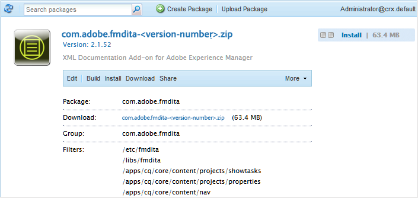

# Download and install AEM Guides for the first time {#id213BCL00KEV}

Perform the following steps to download and install AEM Guides for the first time:

>[!IMPORTANT]
>
> If you want to use Livefyre along with AEM Guides, ensure that you install the Livefyre versions earlier than 3.0 before installing AEM Guides. If you are using Livefyre version 3.0 or higher, then there is no such restriction.

1.  Download AEM Guides from [Adobe Software Distribution Portal](https://experience.adobe.com/#/downloads/content/software-distribution/en/aem.html).

    >[!NOTE]
    >
    >Before installing Experience Manager Guides, ensure your system meets the [technical requirements](../install-conf-guide/aemg-technical-requirements.md).

1.  Log into your AEM instance and navigate to the CRX Package Manager. The default URL to access the package manager is:

    ```http
    http://<server name>:<port>/crx/packmgr/index.jsp
    ```

    The Package Manager manages the packages on your local AEM installation. For more information about working with the Package Manager, see [How to Work With Packages](https://helpx.adobe.com/experience-manager/6-5/sites/administering/using/package-manager.html) in AEM documentation.

    {width="650"}

1.  To upload the AEM Guides package, click **Upload Package**.

1.  In the Upload Package dialog, navigate to the AEM Guides file that you downloaded in Step 1 and click **OK**.

    The package is uploaded to your AEM instance.

1.  To install the package, click **Install**.

    {width="650"}

1.  In the Install Package dialog, click **Install**.

1.  To get started with AEM Guides, click the Home button  in the upper-left corner of the CRX Package Manager.


>[!NOTE]
>
> Perform the installation procedure on all instances of AEM servers in your setup.
