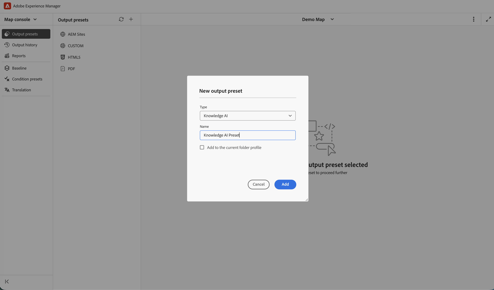
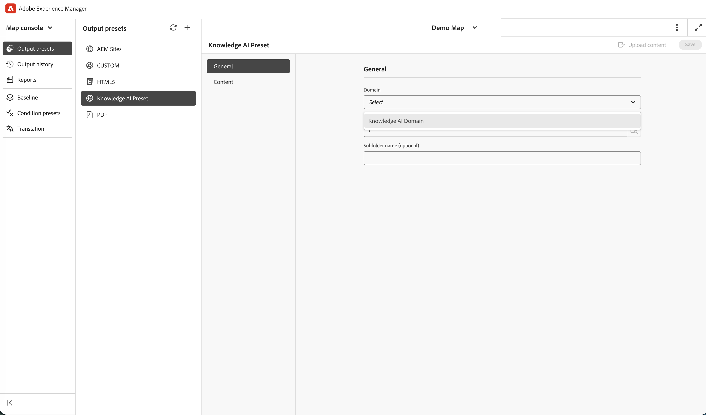
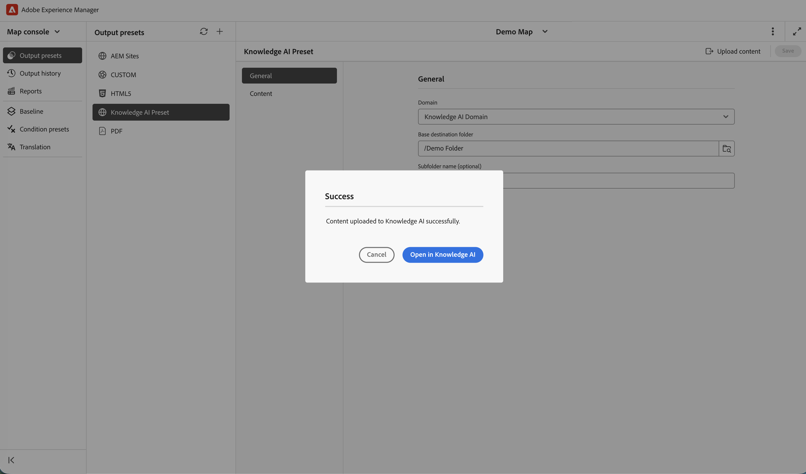

# Connect Adobe Experience Manager Guides with Guides Knowledge AI (Beta)

>[!IMPORTANT]
>
> This feature is disabled by default. To enable the Guides Knowledge AI feature, contact your Customer Success team.

This article provides Administrators and Content engineers with the end-to-end process for configuring Guides Knowledge AI access and uploading Experience Manager Guides content for consumption within Knowledge AI. 

## Process overview

| Step | What you'll do |
|---|---|
| 1 | Create a Service Account in Adobe Developer Console and configure it for your environment. |
| 2 | Retrieve the technical account email from the Service Account credentials file. |
| 3 | Grant the Service Account access in Knowledge AI by creating a role and adding the user. |
| 4 | Configure a Knowledge AI output preset in Experience Manager Guides and upload content. |


## Prerequisites

Ensure you have the following access and permissions before starting:

| Requirement | Purpose |
|---|---|
| Adobe Developer Console | Create the Service Account and download its JSON credentials. |
| Adobe Experience Manager Guides | Author content and configure the output preset for Knowledge AI. |
| [Knowledge AI](https://guidesai.adobe.io/)| Manage roles and users, and receive the uploaded content. |
| Permission: Create Service Accounts | Required in Adobe Developer Console to create a Service Account. |
| Permission: Manage users and roles in Knowledge AI | Required to grant the Service Account access in Knowledge AI. | 


## Create a Service Account

Knowledge AI uses a Service Account to authenticate securely and access content.

1. Follow the instructions in [Configure Microservices IMT Configuration](https://experienceleague.adobe.com/en/docs/experience-manager-guides/using/knowledge-base/kb-articles/publishing/configure-microservices-imt-config)

2. Create a new Service Account and download the generated JSON credentials file.

3. Configure the required environment settings using the downloaded credentials.

Once completed, the Service Account should be successfully associated with your environment.

>[!NOTE]
>
> If you have already created and configured a Service Account for your environment, you can proceed to the next step.


## Retrieve the Technical Account email

To grant access to Knowledge AI, identify the Service Account.

1. Open the downloaded Service Account JSON file.
2. Search for the field name `technical_account_email`.

  View a value similar to the following:

  ```json
  {
  "technical_account_email": "a1b2c3d4e5f6@techacct.adobe.com"
  }
  ```

3. Copy the email address associated with `technical_account_email`.

You'll use this email address in the next step.

## Grant access in Knowledge AI

To allow the Service Account to manage and upload content, add it to Knowledge AI with the appropriate permissions.

1. Open [Knowledge AI](https://guidesai.adobe.io/).
2. Navigate to **Security > Roles** and create a role with the minimal required permissions.
3. Navigate to **Security > Users > Add User**. Add a new user using the `technical_account_email` copied from the Service Account JSON, select the domains from the **Domains** dropdown, and assign the role created in the previous step.

The Service Account is now authorized to perform content administration and upload operations.

## Configure Knowledge AI preset and upload content

To publish content to Knowledge AI, configure Experience Manager Guides once you have set up permissions.

1. Open **Map console** in Experience Manager Guides.
2. Navigate to **Output presets** tab.
3. Select the + icon to create an output preset.
4. Select **Knowledge AI** from the **Type** dropdown in the **New output preset** dialog box. Enter a **Name** and select **Add to current folder profile** to create an output preset within the current folder profile.

     

5. Select **Add**.
    The Knowledge AI preset is created.
4. Open the configured Knowledge AI preset.
5. Select the domain for which the role was granted to the `technical_account_email`,  then select **Upload Content**. 

    This triggers the content upload workflow to Knowledge AI. Wait for the upload process to complete.

       

6. After the upload is complete, select **Open in Knowledge AI**.

    This opens the Knowledge AI chat within the domain, using the uploaded content.

         

You have successfully configured the Service Account, assigned the required permissions, and made your Experience Manager Guides content available in Knowledge AI. Whenever you want to publish updated content, create a new Knowledge AI preset and follow the steps outlined in the [configure the Knowledge AI preset and upload your content](#configure-knowledge-ai-preset-and-upload-content) section above.


