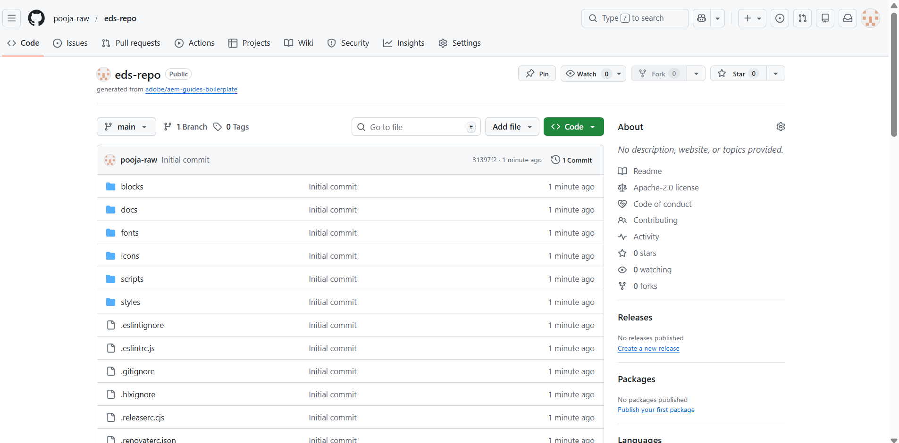
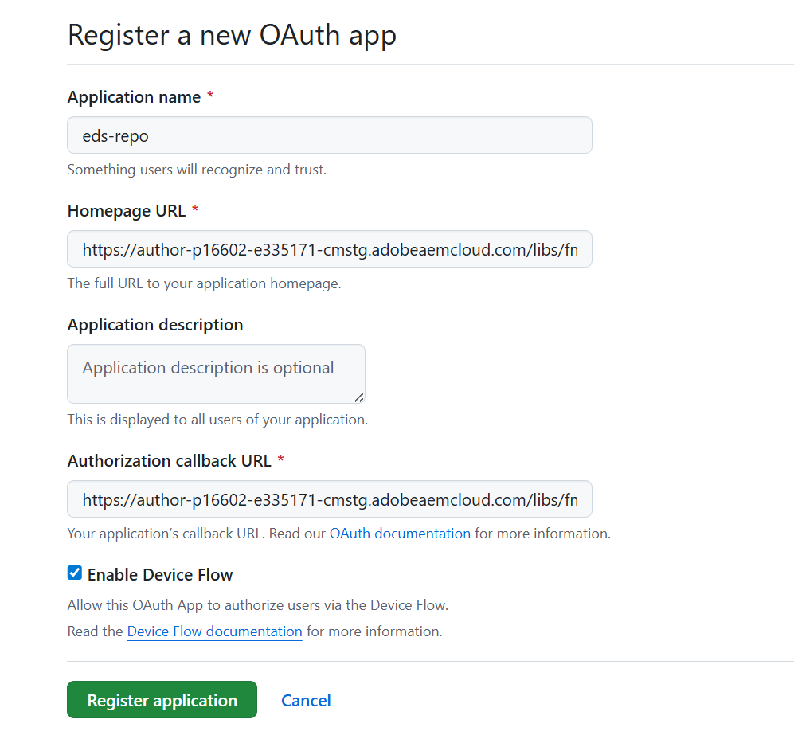
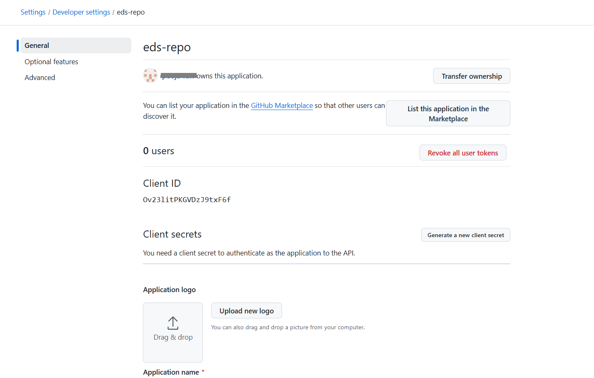
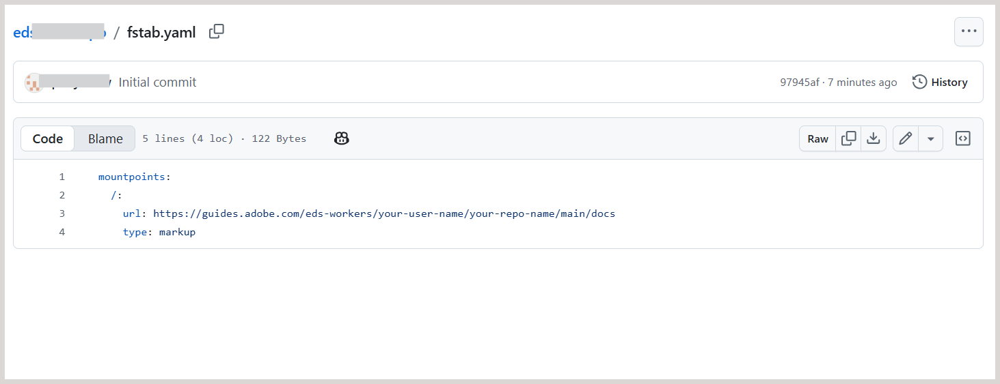
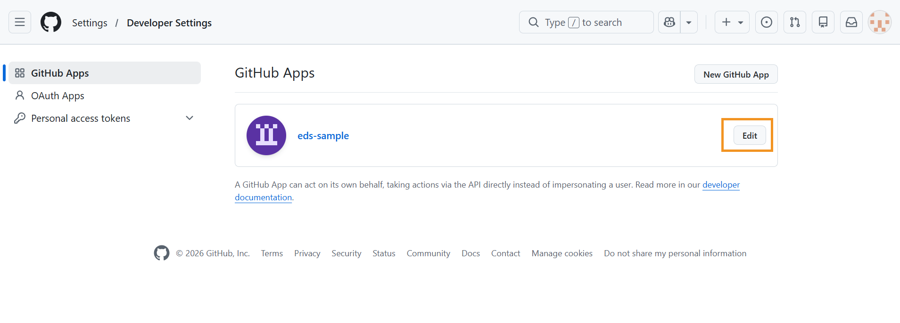
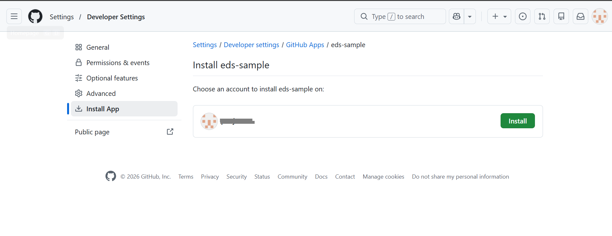
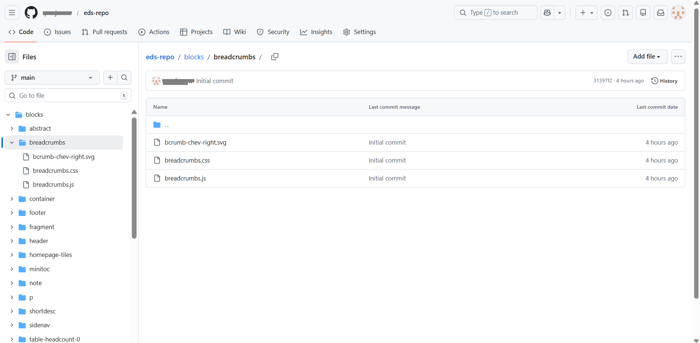
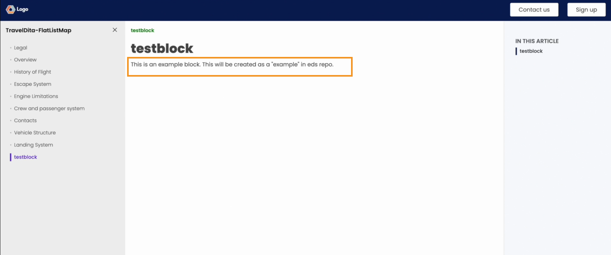

# Experience Manager Guides and Edge Delivery Services

Adobe Experience Manager Guides allows you to publish your DITA content directly to Edge Delivery Services (EDS) through a dedicated GitHub-based publish profile. This capability enables organizations to deliver high-performance, responsive documentation experiences while maintaining DITA-based authoring workflows in Experience Manager Guides.

For more details on using EDS in Adobe Experience Manager, view [Edge Delivery Services Overview](https://experienceleague.adobe.com/en/docs/experience-manager-cloud-service/content/edge-delivery/overview).

To enable publishing from Experience Manager Guides to EDS, you must complete a series of configuration steps across GitHub and Experience Manager Guides. The sections below outline each step in sequence and explain how they work together in the overall publishing workflow.

1. [Set up and configure GitHub for EDS](#set-up-and-configure-github-for-eds)
2. [Create and configure a publish profile for EDS in Experience Manager Guides](#create-and-configure-a-publish-profile-for-eds-in-experience-manager)
3. [Customize output using EDS blocks](#customize-output-using-eds-blocks)

For a quick video walkthrough, view [Publishing in AEM Guides](https://experienceleague.adobe.com/en/docs/experience-manager-guides/using/knowledge-base/expert-session/publishing-in-aem-guides-aug25).

## Set up and configure GitHub for EDS 

This section describes how to set up and configure GitHub for use with EDS. It covers creating a repository using the Adobe boilerplate, connecting GitHub to Adobe Experience Manager through AEM Code Sync, configuring the required GitHub and OAuth applications, and defining the repository mountpoint used for publishing content.

### Create a GitHub Repository for EDS

EDS requires a GitHub repository with a predefined structure. Adobe provides an official boilerplate repository specifically designed for Experience Manager Guides users. 

Perform the following steps to create your repository:

1. Open the Experience Manager Guides boilerplate template repository [aem-guides-boilerplate](https://github.com/adobe/aem-guides-boilerplate).
     

2. Create a new repository using this template. Learn about [Creating a repository from a template](https://docs.github.com/en/repositories/creating-and-managing-repositories/creating-a-repository-from-a-template). Ensure that the repository visibility is set to *Public* so it can be accessed by EDS. 

      

The repository is now created and aligns with the boilerplate template structure.

  

### Create a new OAuth App

An OAuth App is required to authenticate users while creating an EDS publish profile in Experience Manager Guides. It enables a secure login flow using a *Client ID* and *Client Secret*.

Perform the following steps to create a new OAuth App:

1. On GitHub, navigate to the left sidebar and select **Developer settings**.
2. In the left sidebar, select **OAuth Apps**.
3. Select **New OAuth App**.

    {width="650"} 

4. Register your application by providing the following mandatory details:

    - **Application name**: Enter the name of your EDS repository
    - **Homepage URL**: Enter the URL to the Experience Manager Guides instance. (For sample URL format, refer to step 4 of [Create a new GitHub App](#create-a-new-github-app) section).
    - **Authorization callback URL**: Same as Homepage URL

5. Select the **Enable Device Flow** option and then select **Register application** to complete the registration.

    {width="650"} 

Your app is now ready. Note down the *Client ID*. You can generate up to five *Client Secrets* now or later while configuring the publish profile in Experience Manager Guides.

 

### Configure the mountpoint URL in EDS repository

EDS reads content from a GitHub repository path defined as a *mountpoint* URL in the `fstab.yaml` file.

To configure the mountpoint URL in the `fstab.yaml` file:

1. Open the `fstab.yaml` file in your repository and update the following:

    - `your-user-name`
    - `your-repo-name`

    >[!NOTE]
    >
    > In the mountpoint URL, `main` indicates the branch on which you want to publish the content, and `docs` indicates the root folder of the EDS repository you are working on. If you prefer to change the branch name on GitHub, then you must update the same branch name in the *mountpoint* URL (in the `fstab.yaml` file) and corresponding EDS publish profile in Experience Manager Guides. 

    {width="650"}  

2. Select **Commit changes**, enter commit details, and confirm.
3. Return to [Developer settings](https://github.com/settings/apps), locate your app, and select **Edit**.

    {width="650"}  

4. Navigate to the **Install App** page and select **Install**.

     {width="650"} 

5. Repeat steps 2 and 3 from the [Connect GitHub to Adobe via AEM Code Sync](#connect-github-to-adobe-via-aem-code-sync) section to authorize the repository.

### Connect GitHub to Adobe via AEM Code Sync

Adobe Experience Manager uses a GitHub application called **AEM Code Sync** to push content from Experience Manager Guides to GitHub. 

Perform the following steps to install and configure the *AEM Code Sync* application:

1. Navigate to the [AEM Code Sync](https://github.com/apps/aem-code-sync) page and select **Install**.

   **AEM Code Sync** monitors repository changes and ensures that updates are correctly pushed to GitHub.

   > [!NOTE]
   >
   > While installing the application, ensure that you use the same GitHub account that owns the repository.

   

2. On the next page, grant access to the repository you created. Select **Only select repositories**, and then select your repository from the dropdown.

   {width="350"}

3. Select **Install and Authorize**.

   You are redirected to the GitHub setup page.

   

4. Review the source code details and select **Next**.

5. On the **Content source** page, configure the following settings:

   - **Content source type:** Select **Other (bring your own markup)**.
   - **Content source URL:** Review the URL configured as the mountpoint URL in the `fstab.yaml` file. If you have not updated the URL in the file, you can update it here.
   - **File extension:** Change the default `.html` suffix to `.htm`.

   Ensure that **Use a different content source** is selected.

   

6. On the **Users** page, add users if required, and then select **Next**.

7. Review the configuration summary and select **Save**.

   After successful registration, a confirmation page appears. You can copy and save the **Preview** and **Live** URLs for your website from this page.

   

## Set up and configure GitLab for EDS 

For instructions on configuring GitLab as the publishing repository for Edge Delivery Services, view [Set up and configure GitLab for EDS](./configure-eds-gitlab.md).

## Create and configure a publish profile for EDS in Experience Manager 

The sections below outline each step in sequence and explain how to set up EDS publish profile, configure an output preset, and generate output using EDS in Experience Manager Guides.

### Create the EDS publish profile for GitHub or GitLab

1. Go to **[Workspace settings](/help/product-guide/cs-install-guide/workspace-settings.md)** **>** **Publish profiles**.
2. Select the **+** icon to create a new publish profile and provide the following details:

    - **Server type\*:** Select **Git (Edge Delivery Service)** from the dropdown.
    - **Name\*:** Enter a name for the publish profile.
    - **Git account type\*:** Select **GitHub** or **GitLab** from the dropdown, depending on your Git repository provider.
    - **Instance URL\*:** Enter the URL of your GitHub or GitLab instance, for example, `https://github.com` or `https://gitlab.com`.
    - **Repository name\*:** Enter the name of your GitHub or GitLab repository.
    - **User name\*:** Enter your GitHub or GitLab username.
    - **Branch name:** Set to `main` (default).
    - **Root folder\*:** Set to `docs` (default).
    - **Site owner (*GitLab only*):** Enter the owner of the Edge Delivery Services site.
    - **Site repo (*GitLab only*):** Enter the repository name associated with the Edge Delivery Services site.
    - **HLX API key:** Enter the HLX API key for your EDS configuration.
    - **Authentication credentials:** Provide the credentials based on the selected Git account type:
        - **GitHub:** Enter the **Client ID\*** and **Client secret\*** obtained from your GitHub OAuth App. Refer to [Create a new OAuth App](#create-a-new-oauth-app) for details.
        - **GitLab:** Enter the **Access token\*** generated for your GitLab account.
3. Select **Login** to authenticate.

    {width="650"} 

4. On successful authentication, select **Save**.

Your EDS publish profile is now configured.

### Create an Output preset for EDS and generate output

1. Open your map in Map console.
2. In the **Output presets** tab, select **+** to create a new output preset.
3. In the **New output preset** dialog, provide the following details:
    - **Type**: Select **Edge Delivery Service**
    - **Name**: Provide a name for this preset
4. Select **Add**.

    {width="650"} 
5. Open the newly created EDS output preset and configure the following fields:

    - **Conditional filtering:** Select **None** to generate output without filtering or **Using DITAVAL** to apply conditional filtering.
    - **Publish subfolder:** Enter the name of the subfolder where the output to be published
    - **Publish profile:** Select the GitHub or GitLab publish profile configured in the previous section.      

        {width="650"} 

6. Select **Save**, and then **Generate output**.

>[!NOTE]
>
>The generated output is stored in the **docs** folder of the EDS repository.

The EDS output is now generated. The content is presented in a clean, responsive layout. It includes regular elements such as the page title, breadcrumbs, body content, and any blocks used in the topic. The TOC on the left (generated from the map) helps you to navigate across topics, while a mini-TOC on the right highlights the sections within the current page. The entire output is fully responsive, ensuring an optimized, consistent reading experience across devices.

>[!NOTE]
>
> You can publish multiple DITA maps to the same website. The published maps appear in the left navigation panel, allowing users to access content from each map. Publishing a new map does not overwrite the previously published maps.

 

## Customize output using EDS blocks

EDS uses `blocks` to control how different parts of your content are styled and displayed. You can modify existing blocks or create custom ones.

The examples outlined below walk you through customizing an existing block and creating a new block to style the final EDS output in Experience Manager Guides. 

### Customize a breadcrumb block to update its text color

Breadcrumbs are used across pages to help users understand where they are in the documentation. Since this block appears consistently throughout the website, updating its styling allows a unified design update.

Perform the following steps to customize a breadcrumb block to update its text color:

1. Go to your GitHub repository and open the `blocks` folder.
2. Select the **breadcrumbs** block.

    {width="650"} 
3. Open the `css` file and update the text color.
4. Commit the changes to GitHub.
5. Refresh the live website to view the updates.

### Update EDS scripts to create custom element in the published output

In some cases, you may want to style only a specific part of your content. Peform the following steps to achieve this using a custom block.

1. Open the topic file and select the text inside a tag element.

    In the following screenshot, the content inside the `example` tag is selected. 
    {width="650"} 
2. To configure the text inside the `example` tag:
    - Navigate to **Content properties**.
    - Add the `outputclass` attribute.
    - Set its value to `example eds-force-block`.
    - Select **Add**.
     {width="650"} 
3. Save and regenerate the output.
4. Create a new folder with the same name as the `outputclass` inside the `blocks` directory. Learn about [adding files to a repository](https://docs.github.com/en/repositories/working-with-files/managing-files/adding-a-file-to-a-repository#adding-a-file-to-a-repository-using-the-command-line).  

    {width="650"} 

5. Add the required `css` and optional `js` files.

    {width="650"}

6. Commit changes and regenerate output.

The selected content now displays the custom styling defined in your block.

{width="650"}
