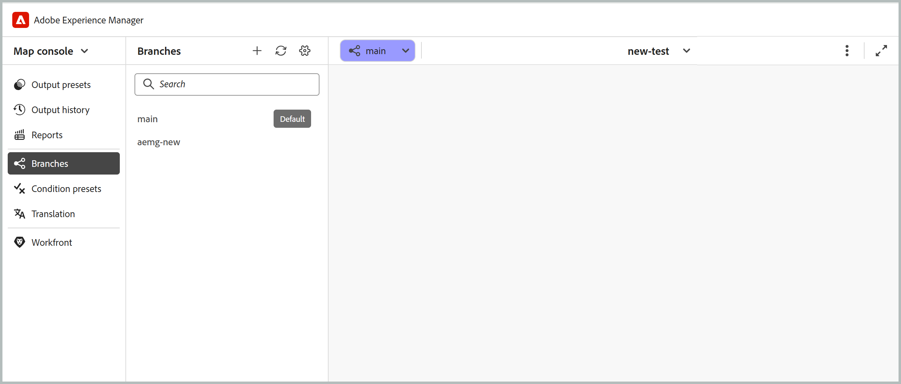
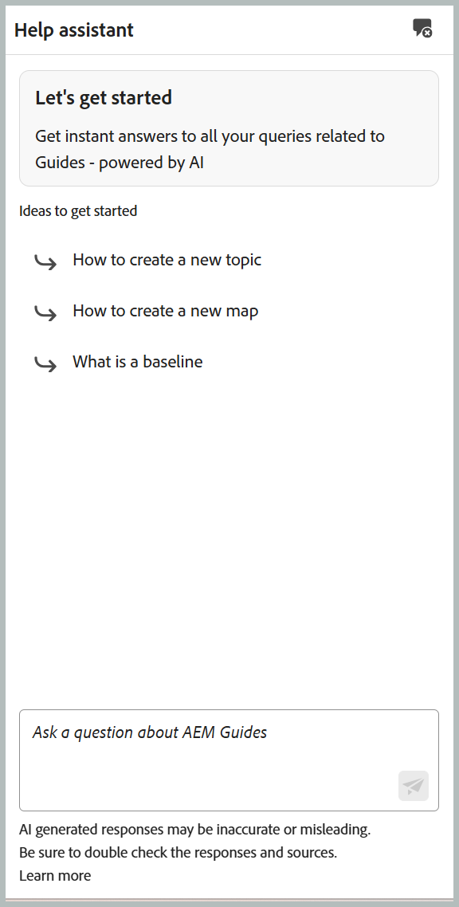
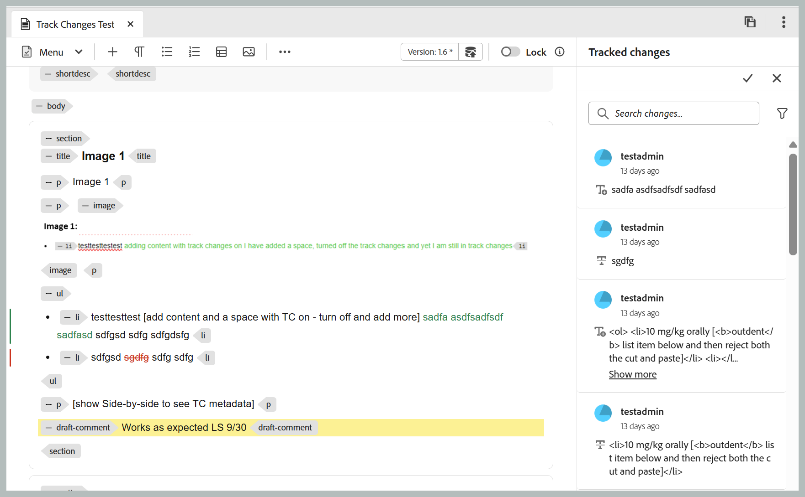

# What's new in the 2026.11.0 release (November 2026)

This article covers the new and enhanced features introduced with the 2026.11.0 release of Adobe Experience Manager Guides as a Cloud Service.

For the list of issues fixed in this release, view [Fixed issues in the 2026.11.0 release](fixed-issues-2026-11-0.md).

Learn about [upgrade instructions for the 2026.11.0 release](../release-info/upgrade-instructions-2026-11-0.md).

## Introducing map-level branching and merging

Adobe Experience Manager Guides introduces map-level branching and merging capability, enabling authors to work on multiple documentation versions, feature updates, and critical fixes in parallel without affecting the main content. Authors can create isolated branches of a DITA map and its dependencies, ensuring that edits, locks, and previews remain specific to each branch.

This capability helps documentation teams manage parallel workstreams, collaborate efficiently, and maintain the stability of the main documentation version. You can:

- **Create branches** from the main version of a DITA map to work on features, enhancements, or critical fixes independently.
- **Switch between branches** in the Editor to manage multiple documentation versions.
- **Manage content versions** to organize changes through branching and merging.
- **Resolve merge conflicts** using a guided comparison workflow with three-way merge.
- **Merge changes** into the main version.
- **Publish directly from a branch** using standard publishing without modifying the main version.

Learn more about [Branching and merging](../user-guide/branching-overview.md).

{width="650"}

## AI-powered content creation and import skills in AI Assistant

>[!NOTE]
>
>To use AI Assistant in Agentic mode, your organization must be onboarded to Adobe CX Enterprise Coworker and have the required credits. 

Now, you can use **AI Assistant** to create and import DITA content using natural-language prompts. Powered by **Adobe CX Enterprise Coworker**, the new **Create** and **Import** skills simplify structured content creation and help authors work with DITA content without requiring extensive DITA expertise.

- **Create:** Generate DITA topics and maps from natural-language prompts, reference documents, or existing content using repository templates. You can review the generated content before saving it and iteratively refine new or existing content to meet your requirements.
- **Import:** Convert existing PDF, DOCX, or Markdown files into structured DITA topics and maps. You can preview and review the converted content before saving it to the repository.
- **Smart Tagging:** Get relevant tag recommendations for your content based on your organization's taxonomy. The enhanced experience allows folder profile administrators to configure taxonomy namespaces in Workspace settings, ensuring consistent and governed tag recommendations.

The **AI Assistant** panel also introduces a fullscreen mode and an **Active conversations** section for an enhanced conversational experience.

For more details, view [Use AI Assistant in Agentic mode](../user-guide/ai-assistant.md#agentic-mode).

{width="650"}

## New Help assistant panel in Experience Manager Guides

The generative AI-powered **Smart Help** capability is now available through the dedicated **Help assistant** panel, accessible from the Homepage, Editor, and Map Console interfaces. The panel provides a conversational search experience, allowing you to ask questions in natural language and quickly find relevant information from the Experience Manager Guides documentation. This helps you access contextual guidance and resolve queries without leaving the Editor, streamlining your authoring workflow.

Administrators can manage the availability of the Help assistant panel through Workspace settings. The **AI Help Assistant** section includes a toggle to enable or disable the panel for users.

For more information, view [Help assistant](../user-guide/ai-based-smart-help.md).

{width="650"}

## Authoring enhancements

### Track changes panel in the New Editor

The **Track changes** panel is now available in the New Editor, allowing you to view all tracked insertions and deletions within a topic. You can track edits made by multiple users and accept or reject changes directly from the panel.

You can also control how deleted content appears in the Editor using the **Show tracked deletions inline** setting that lets you display deleted content as strikethrough text or replace it with a pencil icon linked to the corresponding change. Learn more about [Track changes](../user-guide/config-editor-settings.md#track-changes).

{width="650"}

### Sort files and folders in the Explorer panel

The **Explorer** panel in the Editor allows you to sort files and folders in ascending or descending order using the **Sort** button. By default, items are sorted in ascending order by title or file name, based on the **Editor files display** setting in **User preferences**. This makes it easier to navigate and locate content in the Editor.

For more information, view [Explorer](../user-guide/paginated-loading-assets.md#explorer) section in Paginated loading of files and folders.

### Manage versions and labels for non-DITA files from the Editor

Experience Manager Guides allows you to view version history and manage version labels for non-DITA files, such as images, multimedia, ZIP, PDF, and DOCX files, directly from the Editor. You can preview these files, review their version history, compare versions, and revert to an earlier version without navigating to the Assets UI. You can also apply or update version labels for existing file versions to simplify version identification and management.

For more information, view [Work with media and other non-DITA files](../user-guide/authoring-file-management.md#work-with-media-and-other-non-dita-files).

{width="650"}

## Review enhancements

### Enhanced review collaboration with initiator comments

Review initiators can add inline comments and annotations to topics within a review task using the Review UI. This allows them to provide additional context, highlight specific content, and draw reviewers' attention to areas that require feedback.

These comments appear in the **Comments** panel alongside feedback from other reviewers, providing a consolidated view of the review discussions. Reviewers also receive an AEM notification when the initiator adds a comment, helping streamline collaboration and communication throughout the review process. For more information, view [Add comments for reviewers](../user-guide/review-send-topics-for-review.md#add-comments-for-reviewers).

## Publishing enhancements

### View and manage output history from the Map Console

The Map console in Experience Manager Guides now includes an **Output history** tab, allowing you to view and manage output generation tasks directly from the Editor without navigating to the Map Dashboard.

The tab provides a consolidated view of output generation tasks, including their status, preset details, generation date, and duration. You can search and filter tasks, cancel ongoing generations, access generated outputs and logs, and remove completed entries from the history. You can also export the output history as a CSV file for further analysis. Output generation statuses use color indicators consistent with the Map dashboard. 

For details, view [Manage output generation process](../user-guide/generate-output-manage-process.md#view-and-manage-output-generation-tasks-from-the-editor).

{width="650"}

### Enhanced output history purging options

You can purge output history **By age** (removing entries older than a specified number of days) or **By count** (keeping only a specified number of recent entries).

You can also choose to purge only the output logs while preserving the history entries for audit purposes, or remove both the logs and their associated entries. These options help optimize repository storage while providing greater control over output history purging.

For more information, view [Configure auto-purging period for output history](../install-conf-guide/conf-output-generation.md#configure-auto-purging-period-for-output-history-id19aai070v8q).

### GitLab support for Edge Delivery Services publishing profiles

Edge Delivery Services publishing supports GitLab-hosted repositories alongside GitHub, providing greater flexibility in managing and publishing DITA content. To publish to a GitLab-hosted site, select GitLab as the server type when creating an Edge Delivery Services publishing profile and provide the repository's project access token in the Access Token field.

Publish presets also include a field for a subfolder, so you can publish content to a subfolder within the root folder specified in the profile.

For more details, view [Configure an Edge Delivery Services](../knowledge-base/publishing/configure-eds.md).

### Enhancements to Salesforce publishing

Experience Manager Guides enhances Salesforce publishing with improved security, performance, and publishing efficiency. These enhancements include support for Proof Key for Code Exchange (PKCE), refresh token-based authentication, article-level publishing status, detailed publishing logs, output history, and optimized asset publishing to reduce redundant uploads.

For more information, view [Enhanced Salesforce publishing using backend processing](../user-guide/web-editor-article-publishing.md#enhanced-salesforce-publishing-using-backend-processing).

### Support for images from map metadata in Native PDF

Native PDF publishing supports the dynamic display of images defined in the metadata of DITA maps, bookmaps, and custom maps. You can use a single PDF template across multiple maps while displaying map-specific images, such as product cover images, in the generated output.

By adding an image placeholder to the page layout, you can automatically populate it with the image referenced in the map metadata during publishing. This eliminates the need to maintain separate templates for different images and simplifies template management.

For more information, view [Add an image from map metadata](../native-pdf/design-page-layout.md#add-an-image-from-map-metadata-add-image-map-metadata).

### Validate content quality with content health check in Old Editor

Content health check is available in the Old Editor (already supported with New Editor), helping validate content quality across DITA maps before publishing. Administrators can create reusable health check presets by combining checks for broken links, duplicate IDs, and Schematron validation.

Authors can run a health check on a DITA map or a selected baseline in the Old Editor to generate a consolidated report of issues across associated topics and maps. For details, view [Run health check on a map](../user-guide/map-editor-other-features.md#run-health-check-on-a-map).

## Upsert API for legacy content migration

This API allows you to create or update content and its metadata through a single API. It supports specifying topic content, metadata, and a GUID in the request. The API is available in the Swagger API documentation at `/bin/guides/v1/asset/upsert/`.