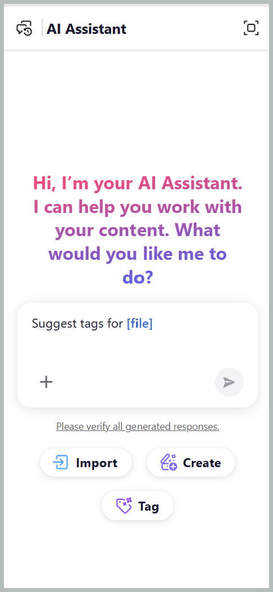
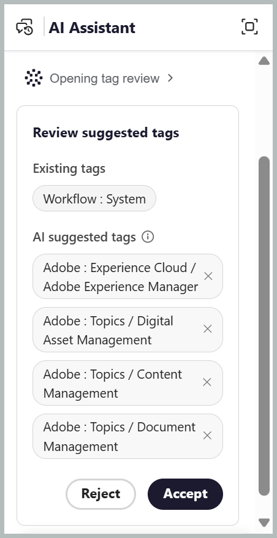
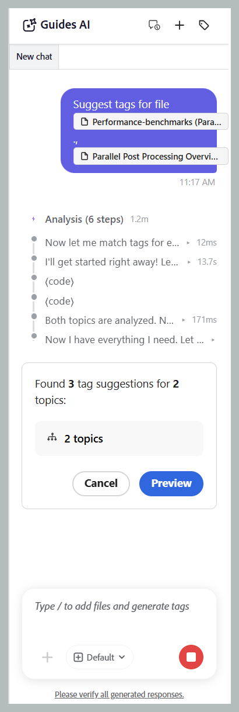
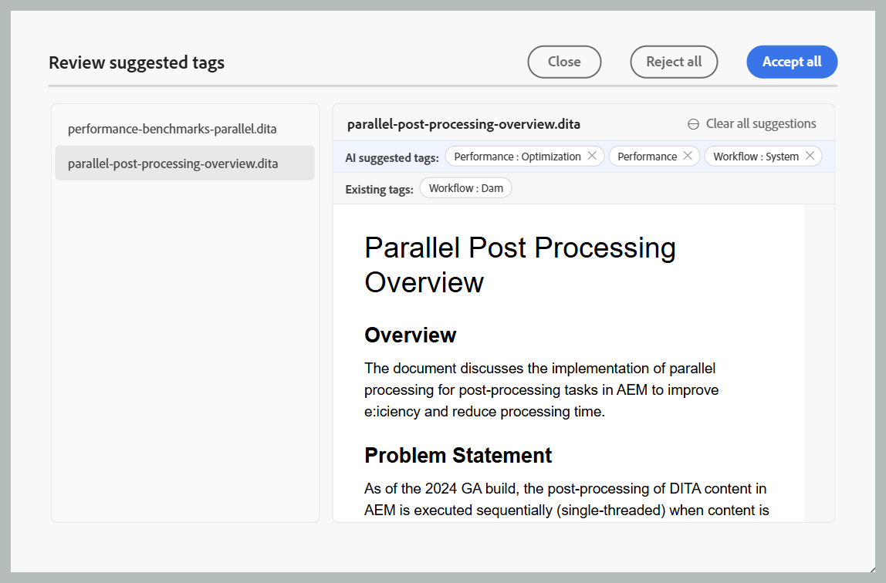
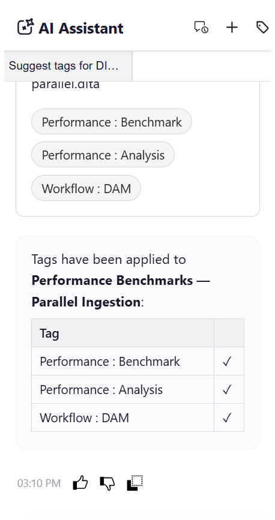

# Smart tagging with AI Assistant

The Smart tagging skill, available in AI Assistant's Agentic mode through Adobe CX Enterprise Coworker, makes tagging your content faster, easier, and more consistent. It analyzes your content and recommends relevant tags based on your organization's taxonomy, eliminating the need to manually review content and identify applicable tags. Your Administrator can configure the taxonomies used to generate tag recommendations through [Workspace settings](../install-conf-guide/workspace-settings.md#general) by selecting the relevant namespaces for your workspace.

You stay in control by reviewing the suggested tags and choosing to apply or reject them before confirming your selection. This reduces manual effort, improves tagging accuracy, and helps maintain consistent metadata across your documentation.

## Apply tags to single or multiple topics with the smart-tagging skill

Perform the following steps to use AI Assistant for applying tags to single or multiple topics with the smart-tagging skill: 

1. Log in to Experience Manager Guides.
1. On the Home page, select **AI Assistant** from the Navigation bar. Ensure that the [AI Assistant in Agentic mode](../install-conf-guide/workspace-settings.md) is enabled by your Administrator.
1. Add the topic for which you want to generate tag recommendations using one of the following methods:

    - **Using Suggested prompts**: For the first chat in the Response area, select **Suggest tags for a file** prompt. The prompt gets automatically added to the Prompt space. Select `[file]`, then choose the topic from the Repository or a Collection in the **Select file** dialog. You can select one topic from the **Select file** dialog.

        {width="650"}

    - **Using shortcut**: Type `/` in the Prompt field, then choose **Add repository reference** to choose a topic from the Repository (or **Add files from device** to upload a topic from your computer), and enter a prompt like *Suggest tags for a file*.    

    - **Drag and drop**: Drag and drop a single topic or multiple topics into the Prompt space, and enter a prompt like *Suggest tags for a file*.

        {width="650"}

    - **Specify topic paths**: Type `@` followed by the comma-separated paths for multiple topics from the same or different maps, and enter a prompt like *Suggest tags for a file*.

        {width="650"}              

1. Select **Send**.        

1. AI Assistant analyzes the content of the topic and generates tag recommendations.

    {width="650"}

1. Review the suggested tags, as follows:

    >[!NOTE]
    >
    > For topics that already contain tags, AI Assistant displays the existing tags. These tags are read-only and cannot be modified or removed.

    - For single topic, you can **Accept** the recommendations to apply them, or **Reject** them if they are not required.

        {width="650"}

    - For multiple topics: 
        1. Select **Preview** to review the AI-generated tag recommendations.

            {width="650"}

        1. Review the suggested tags for each topic, and then choose one of the following actions:
            - **Accept all** to apply all suggested tags for all the topics.
            - **Reject all** to discard all suggested tags for all the topics.
            - **Clear all suggestions** to remove all the suggested tags for a specific topic.
            - Select the **X** icon next to a tag to remove an individual tag suggestion.

                {width="650"}

1. When you accept the suggested tags, the Smart Tagging skill adds the AI-generated tags to the tags already applied to the content.                

After you complete the review, the AI Assistant displays a summary of the tags applied to the topic and any rejected tag recommendations.

{width="650"}

## Apply tags to multiple topics of a map using smart-tagging skill

Perform the following steps to use AI Assistant for applying tags to multiple topics of a map with the smart-tagging skill: 

1. Log in to Experience Manager Guides.
1. On the Home page, select **AI Assistant** from the Navigation bar. Ensure that the AI Assistant in Agentic mode is enabled by your Administrator.
1. Add the map for which you want to generate tag recommendations using any one of the following methods as discussed for topics:

    - **Using Suggested prompts**: For the first chat in the Response area, select **Suggest tags for a file** prompt. The prompt is automatically added to the Prompt space. Select `[file]`, then choose the map from the Repository or a Collection in the **Select file** dialog.   

    - **Drag and drop**: Drag and drop a map into the Prompt space, and enter a prompt like *Suggest tags for a file*.

    - **Using shortcut**: Type `/` in the Prompt field, then choose **Add repository reference** to choose a map from the Repository (or **Add files from device** to upload a map from your computer), and enter a prompt like *Suggest tags for a file*. 

        {width="650"} 

1. Select **Send**.
    A message indicates that the selected map contains multiple topics. Select **Select topics** to choose the topics for which you want tag recommendations.

    {width="650"}

1. In the **Select topics** dialog, select the topics for which you want tag recommendations.   
   The **Select topics** dialog provides the following:

    - **Topics list:** Displays all topics in the selected map. Select the topics for which you want to generate tag recommendations.
    - **Preview pane:** Displays a preview of the selected topic along with its existing tags.
    - **Filter:** Filter the topics to display only those with **Tags added** or **No tags added**.   

        {width="650"}  
        
1. Select **Confirm**. AI Assistant analyzes the selected topics and displays the number of tag recommendations generated for each topic.
1. Select **Preview** to review the AI-generated tag recommendations.  
1. Review the suggested tags for each topic, and then choose one of the following actions:
   - **Accept** to apply all suggested tags for all the topics.
   - **Reject** to discard all suggested tags for all the topics.
   - **Clear all suggestions** to remove all the suggested tags for a specific topic.
   - Select the **X** icon next to a tag to remove an individual tag suggestion.

        >[!NOTE]
        >
        > For topics that already contain tags, AI Assistant displays the existing tags. These tags are read-only and cannot be modified or removed.

    {width="650"}

1. When you accept the suggested tags, the smart-tagging skill adds the AI-generated tags to the tags already applied to the content.     

After you complete the review, AI Assistant displays a summary of the tags applied to each topic and any rejected tag recommendations.

