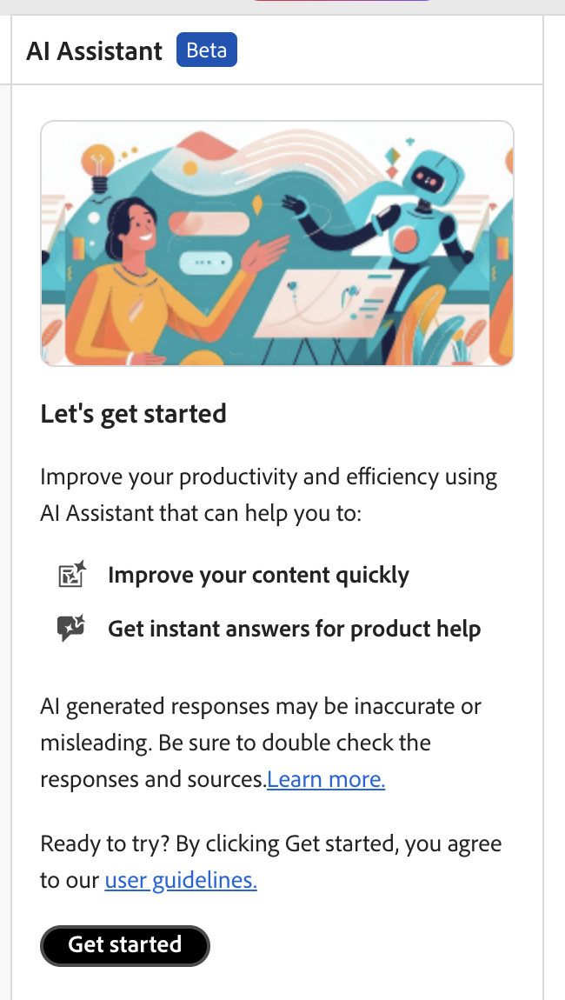

# AI Assistant

>[!NOTE]
>
> The AI Assistant feature is currently available for Adobe Experience Manager Guides as a Cloud Service. 

The AI Assistant in Adobe Experience Manager Guides is an AI-powered tool designed to enhance productivity by simplifying content creation, management, and authoring workflows. It offers two modes: Standard and Agentic. In **Standard mode**, AI Assistant provides authoring assistance and access to Experience Manager Guides documentation, helping you create, refine, and manage content more efficiently. In **Agentic mode**, AI Assistant enables you to perform content-related tasks through natural language interactions, with skills such as Import, Create, and Smart tagging to streamline content creation, organization, and metadata management.

## AI Assistant modes

>[!NOTE]
>
>To enable the AI Assistant in Agentic mode for your environment, contact the Customer Success Team.
 
AI Assistant is available in two modes: **Agentic** and **Standard**. Administrators can select the mode from the **AI features** section of the **General** tab in **Workspace settings**. The AI Assistant panel remains the same in both modes in the Editor, but the available capabilities differ:

- **Agentic mode:** Uses skills from Adobe CX Enterprise Coworker, including **Import**, **Create**, and **Smart tagging**, to convert files into structured topics, generate content, and recommend relevant tags based on your organization's taxonomy.
- **Standard mode:** Provides AI-powered authoring assistance through contextual actions, such as content reuse, translation, and content quality improvements, to streamline authoring workflows.

## Agentic mode

>[!NOTE]
>
> AI Assistant in Agentic mode is available in Experience Manager Guides as a Cloud Service starting with the 2026.11.0 release. It requires your organization to be onboarded to CX Enterprise Coworker; once onboarded, contact your Customer Success team to enable the feature. For configuration details, view [Configure AI Assistant in Agentic Mode](../install-conf-guide/configure-ai-assistant-agentic-mode-cs.md).

Agentic mode in AI Assistant enables you to perform a wide range of content-related tasks through natural language interactions, such as creating and importing content, summarizing topics, adding topics to maps, and managing metadata. You can describe your requirements in the chat panel, and AI Assistant plans and executes tasks while providing visibility into their progress. Agentic mode provides quick access to the following skills:

- **Import**: Converts PDF, Word, or Markdown files from your device or content repository into structured topics. For more details, view [Import content with AI Assistant](./import-ai-assistant.md).

- **Create**: Generates new topics based on your requirements, with options to reference existing content for tone and style. For more details, view [Create content with AI Assistant](./create-ai-assistant.md).

- **Smart Tagging**: Recommends relevant tags for topics based on your organization's taxonomy to improve metadata consistency. For more details, view [Smart tagging with AI Assistant](./ai-assistant-agentic.md).

The following components of the AI Assistant panel help you add content, enter prompts, and start tasks:

- **(A)** Conversation history: View and reopen previous conversations to review earlier requests and responses.
- **(B)** Full screen: Expands the AI Assistant panel to full screen.
- **(C)** Prompt space: Enter a prompt request, or type `/` to add files and generate tags.
- **(D)** Attach files or add context: Adds topics, maps, or files from your repository or local system to provide the content that AI Assistant works with.
- **(E)** Send: Submit your prompt and attached content to AI Assistant.
- **(F)** Quick actions: Start a task directly from one of the following shortcuts: **Import**, **Create**, or **Tag**.

## Standard mode

Standard mode makes your authoring process smarter and faster. When you select text in the Editor, the AI Assistant offers quick actions, such as generating intelligent suggestions for content reuse, translating content, improving content quality, and more, all based on your selected content. This enhances the overall authoring experience and the productivity of authors.

For more details, view [Author documents with AI Assistant](./ai-assistant-right-panel.md).

## Get started with AI Assistant in Standard mode

When you use the **AI Assistant** in Standard mode for the first-time, you are prompted to submit your consent before you use the Experience Manager Guides Generative AI features. 

Perform the following steps to launch AI Assistant: 

1. Login to Experience Manager Guides.
1. On the Home page, select **AI Assistant** from the top. Ensure that your Administrator has enabled the AI Assistant feature in the desired mode. 

The AI Assistant displays the key features, user guidelines link, and a **Get started** button.

  

  Read the user guidelines carefully and then select  **Get started** to launch the AI Assistant. 

**Related topics**

[AI Assistant security FAQ](./ai-assistant-faq.md)

[Adobe Experience Manager Guides Generative AI disclosures](./adobe-generative-ai-disclosures.md)

[Configure AI Assistant for smart help and authoring](../cs-install-guide/conf-smart-suggestions.md)
