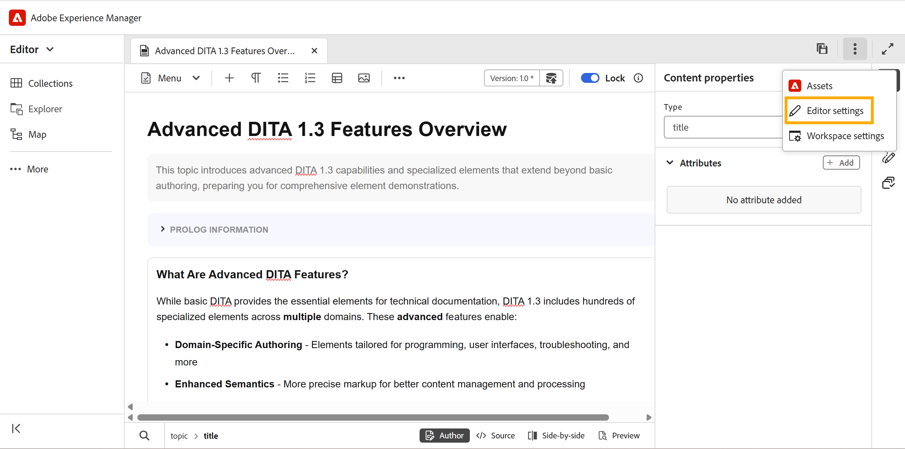
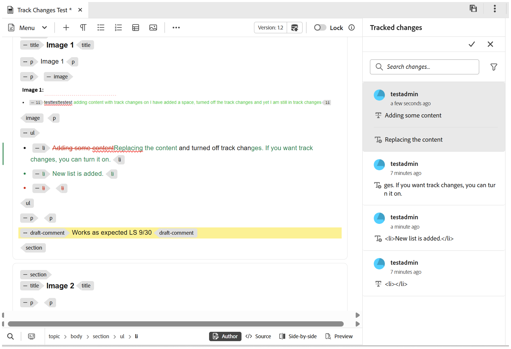
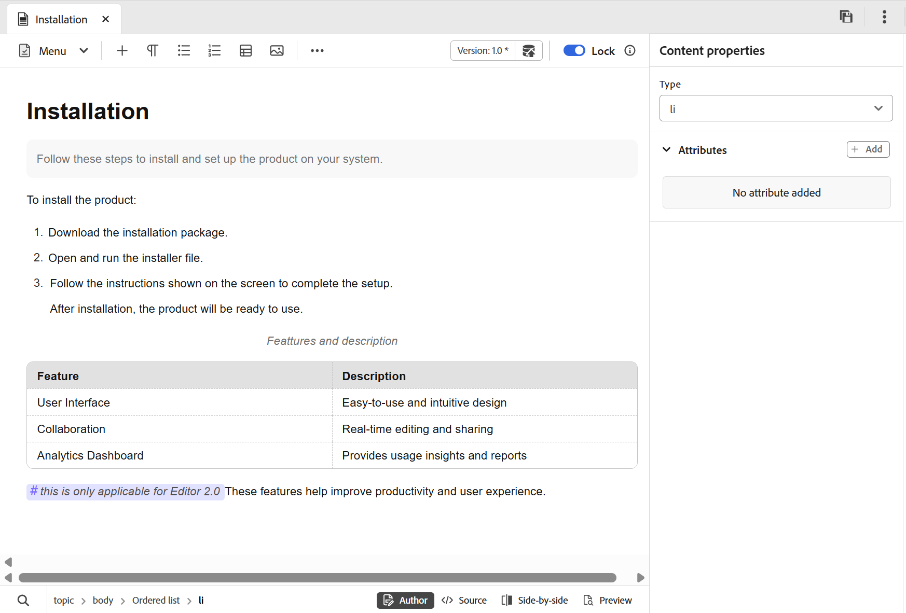
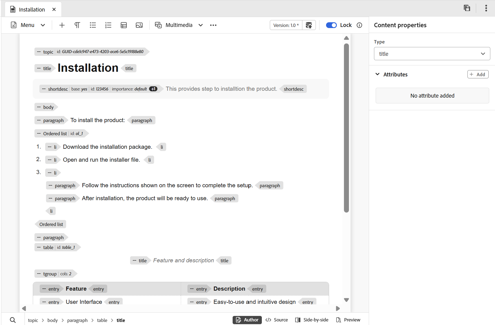
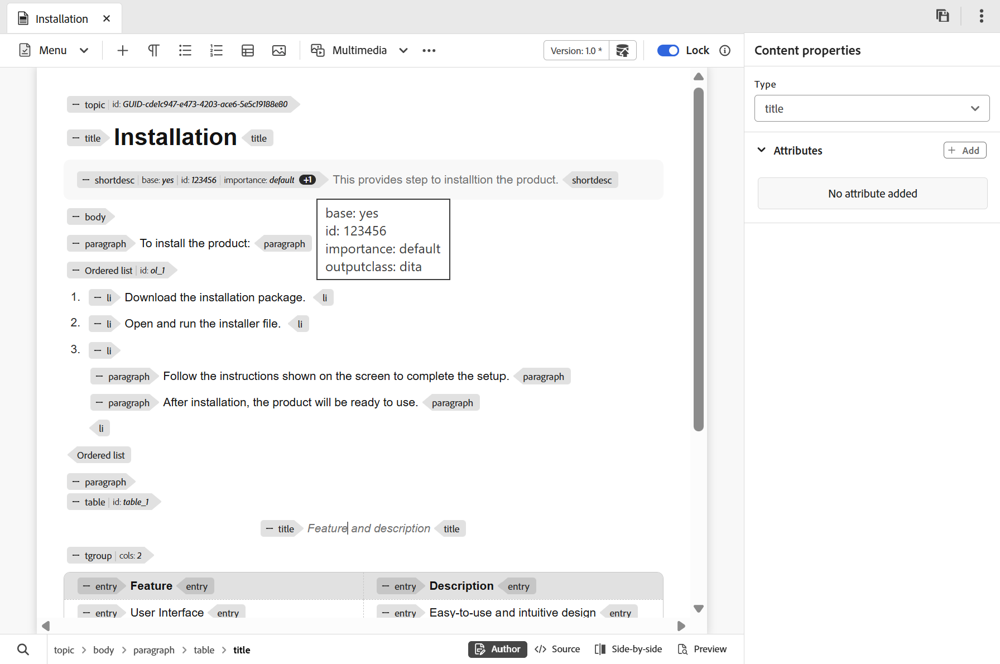

# Editor settings

>[!NOTE]
>
> This article only applies to the New Editor. To enable this capability in your environment, contact the AEM Guides Customer Success team.

The Editor settings provides a centralized configuration panel that allows you to customize Editor behavior at an individual author level. It provide greater flexibility, consistency, and control during the authoring process.

This centralized settings panel enables you to manage key Editor preferences from a single location, reducing the need for scattered or manual configurations. The Editor settings can be accessed from the **More actions** on the Tab bar.

{width="650"}

## Supported configuration options

You can enable or disable the following options based on your preferences:

{width="350"}

- **Track changes**: Enable this option to track the insertions and deletions you make while editing. All changes are listed in the Tracked changes panel. Inserting or deleting any content within a paragraph or list item is tracked along with its tags and listed as a change to the whole element. Multiple changes to the content within the same tag are captured together and shown as a single entry in the panel.

    >[!NOTE]
    >
    >- To enable this capability in your environment, contact the AEM Guides Customer Success team.
    >- When working with tables, the insertion of a row or column is tracked, but the deletion of a row or column is not tracked within the Track changes panel.

    {width="350"}

- **Show tracked deletions inline**: Controls how deleted content is displayed in the Editor while Track changes is on. When enabled, deleted content remains visible inline, at its original position, as strikethrough text. When disabled, the deleted content is not shown. Instead, a pencil icon appears at the location where the content was removed, giving you a cleaner view of your topic. Select the pencil icon to go to the corresponding deleted content in the Tracked changes panel.

    {width="350"}

- **Non breaking spaces**: Enable this option to show an indicator for the non-breaking spaces while editing it in the Editor. It is visible only in the Author view for DITA topic and DITA maps
- **XML comments**: Enables authors to view, edit, and insert XML comments directly in Author mode, for better visibility within the content. When enabled, authors can view, insert, edit, and delete XML comments directly within the content in the Author mode itself, making it easier to add contextual notes for collaborators. When disabled, XML comments are hidden in Author mode and cannot be inserted or modified from Author mode, ensuring a cleaner authoring experience for users who do not require them. You can continue to view and author XML comments in source mode using the `<!-- test comment -->` syntax.

    >[!NOTE]
    >
    > Track changes feature (when enabled) is not supported for edits within XML comments. However, inserting or deleting an entire XML comment is tracked as a change.

    {width="650"}

- **Tags**: Controls the visibility of tags in the Editor. When enabled, structural tags are displayed within the content, allowing authors to view and manage the underlying DITA structure. When disabled, these tags are hidden to provide a cleaner and more focused authoring experience.

    {width="650"}

    When **Show tags** settings is enabled, you can also enable **Display attributes** to view and validate the attributes associated with an element. When an element has more than three attributes associated with them, a count indicator appears. Hovering over the indicator displays the complete list of attributes applied to that element.

     {width="650"}

- **Quick insert menu in editor**: Enables adding elements directly while editing in Author mode at the cursor position without navigating to the toolbar. Frequently used elements can also be configured in the **Favorites** for quicker access. The quick insert menu is available directly in the Editor when you press **Control + /** on Windows or **Command + /** on macOS the cursor position.

    {width="650"}

    You can search for and add elements to your Favorites, remove any previously added elements, and rearrange them using simple drag-and-drop. Favorites include your most frequently used elements, and the order you set here is reflected in the Quick Insert menu when accessed from the editor. 

    Here's a short video on how to work with the Quick insert menu in the New Editor.

    >[!VIDEO](https://video.tv.adobe.com/v/3491343)

