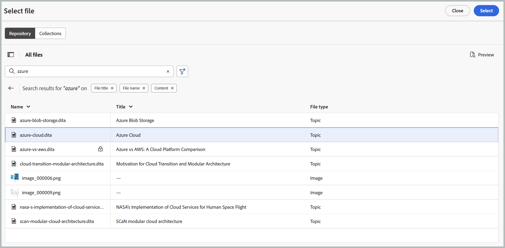
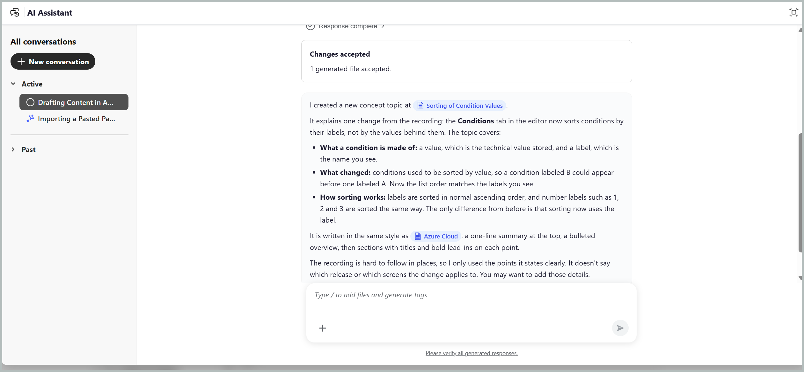
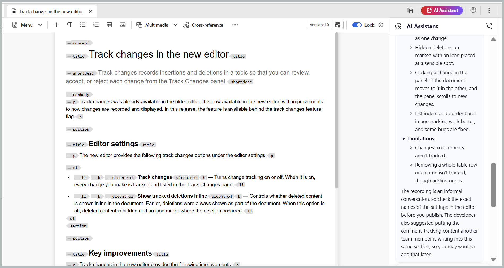

# Create first draft of your content 

The **Create** skill in AI Assistant's Agentic mode helps you generate the first draft of structured content from notes, specifications, whiteboard images, screenshots, or other available reference materials. The skill automatically identifies the appropriate DITA topic type, such as Concept, Task, Reference, or Troubleshooting, based on the content and topic templates available in your repository, reducing the manual effort required to structure and author content.

You can attach a file, select an existing file as a reference for tone and style, and specify the folder where you want to save the generated content. To create topics from files, follow these steps:

1. Log in to Experience Manager Guides.
1. On the Home page, select **AI Assistant** from the Navigation bar. Ensure that the [AI Assistant in Agentic mode](../install-conf-guide/workspace-settings.md) is enabled by your Administrator.

1. Select **Create** from the AI Assistant panel.

   The starter prompt appears in the prompt box: `Create draft content referring to attached file(s) and having tone of content similar to [file]`

1. Attach your notes, specification, or other reference files to the prompt using any of the following methods: 

   - **Using shortcut**: Type `/` in the Prompt field, then choose **Add repository reference** to choose the file from the Repository (or **Add files from device** to upload the file from your computer).

   - **Using `Attach files or add context` icon (+)**: Adds files from your local system. 

   - **Drag and drop**: Drag and drop the file you want to draft from the system directly into the prompt space.   

1. *(Optional)* In the prompt, select `[file]`. Select the existing topic whose tone you want the draft to match. You can choose the topic from the repository or from a collection. The topic name replaces `[file]` in the prompt.

   {width="350"}

1. Select **Send**.

   AI Assistant analyzes the content and lists each step it completes.

1. Answer any follow-up questions from AI Assistant to provide the details needed to generate the content.

      {width="350"}

1. Select **Preview** to review the generated topic.

   Check each draft against your source material and the topic types you asked for.

      

1. Select one of the following:

   - **Accept** to save the topic to the folder you confirmed
   - **Reject** to discard the changes without saving anything. You can provide a reason for rejecting the draft content and enter a prompt specifying the changes you want. The AI Assistant uses your feedback to revise the draft content.      

      The topic is now available in your repository.

      

After AI Assistant creates a topic, you can open it in the Editor and refine the content using follow-up prompts. This allows you to improve the topic iteratively without starting a new conversation. Each proposed change is displayed in the preview with **Track Changes** enabled, allowing you to review the modifications before applying them.

For example, to refine the title of a generated topic:

1. Open the newly created topic in the Editor from the AI Assistant dialog.

   

1. In the AI Assistant panel, enter a follow-up prompt, such as `Improve the title of this topic to make it generic.`

   

1. Select **Send**.

   AI Assistant analyzes and suggests a new title.

1. Select **Preview** to review the proposed changes.

   The preview displays the revised title with tracked changes, highlighting what has been modified.

   

1. Select **Accept** to apply the changes to the topic.

   

You can continue refining other elements of the topic, such as paragraphs, steps, or tables, by providing additional prompts in the same conversation.

