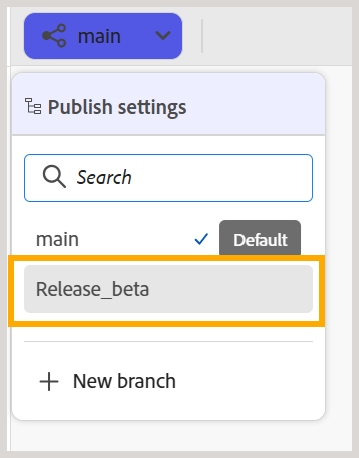
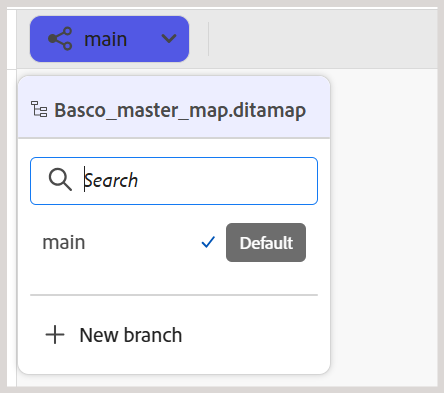
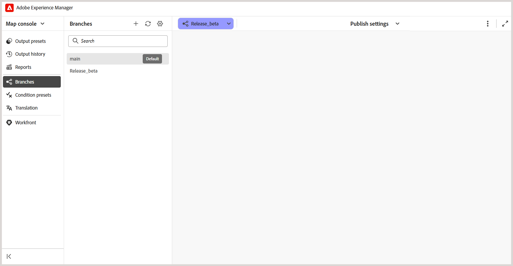

# Create and manage branches of a DITA map

In Experience Manager Guides, you can create multiple branches of a DITA map to manage documentation for different releases, features, or fixes. You can switch between branches to work on the associated content, archive branches that are no longer required, and restore them when needed.

You can also create a branch from any existing branch of the same DITA map.

## Create a branch

You can create a branch of a DITA map to work on documentation changes without affecting the corresponding content in other branches.

Perform the following steps to create a branch:

1. Open the DITA map for which you want to create a branch.

   >[!NOTE]
   >
   > If another map is already open in the Editor, a confirmation dialog appears. Select **Open** to open the selected map in the current branch. For more information, view [Open content outside the current map context](#open-content-outside-the-current-map-context).

1. Select the **main** branch dropdown and verify that the required DITA map is selected.

   

1. Select **New branch** to create a branch of the selected map.

1. In the **New branch** dialog, enter a name for the new branch and select the parent branch from which you want to create it.

    

1. Select **Create**.

A new branch is created for the selected DITA map. You can now switch to the new branch and begin working on its associated content.

## Switch between the branches

Perform the following steps to switch branches:

1. Select the **branch dropdown** at the top of the Editor (which displays `main` by default). The list of available branches for the selected DITA map is displayed.
1. Select the branch you want to work with.

   

   The selected branch opens, and its name appears in the branch dropdown at the top of the Editor, replacing **main**.

   

You can now work on the map and its associated content within the selected branch.

   

>[!NOTE]
>
>If a topic has unsaved changes when you switch branches, a dialog appears prompting you to save the changes before switching to the selected branch.

You can now work on the map and its associated content within the selected branch.

## Isolated editing in a branch

When you work in a branch of a DITA map, changes made to its content remain within the selected branch and do not affect the corresponding content in other branches. This allows multiple authors to work on the same topics independently across different branches of a map.

By default, unchanged topics are read from the source branch or `main`. When you edit a topic in the selected branch, it becomes part of that branch. Any subsequent changes to the topic remain within the selected branch.

You can switch between branches of the same DITA map to view and edit their respective content.

### Edit topics within a branch

You can edit topics associated with a DITA map in the selected branch without affecting their content in other branches.

Perform the following steps to edit a topic:

1. Open the DITA map in the Editor.
2. From the branch dropdown, select the branch in which you want to edit the topic.
3. Open the topic you want to modify from the map.
4. Make the required changes to the topic.
5. Save your changes.

   A copy of the modified topic is saved in the selected branch. The corresponding topic in other branches remains unchanged.

You can continue editing the topic in the selected branch or switch to another branch to work on its content.

### Open a map outside the current map context

In Experience Manager Guides, **map context** refers to the DITA map currently open in the Editor.

If you try to open a map, topic, or asset that is not part of the current map context, a confirmation dialog appears with the following options:

- **Open:** Replaces the current map context with the selected content.
- **Open in editor:** Opens the content in a new tab without changing the current map context.
- **Cancel:** Cancels the operation and retains the current map context.

For example, consider that `Basco_master_map.ditamap` is currently selected in the **main** branch.

If you try to open another DITA map, the following confirmation dialog appears:

Select **Open** to switch to the selected map.

The map context of the `main` branch is updated to the newly selected map, allowing you to work with its associated content.

### Open or edit topics outside the current map context

Topics that are not referenced by the map aren't automatically available in the branch. 

Select **Edit in current branch** to make such topics available for editing in the selected branch.

You can now edit the topic without affecting its content in `main`. However, the topic is not automatically added to the associated DITA map and is not included in the published output. To include the topic in the output, add it to the DITA map.

## Manage branches

You can manage branches of a DITA map from the **Branches** panel in the Map console. You can view available branches, create new branches, merge or rename existing branches, and archive branches that are no longer actively used.

The **Branches** panel lists all the available branches for the selected DITA map.

To manage a branch, hover over the required branch and select the **Options** menu. The following actions are available:

- **New branch:** Create a new branch from the selected branch.
- **Merge into main:** [Merge changes](./merge-branches.md) from the selected branch into the `main` branch.
- **Rename branch:** Change the name of the selected branch.
- **Merge history:** Displays a history of merge activities. This option is available only after a merge request has been created.
- **Archive branch:** Archive a branch that is no longer actively used.

  >[!NOTE]
  >
  > Experience Manager Guides does not support deleting branches. You can archive branches that are no longer actively used.

You can also use the options at the top of the **Branches** panel to search for a branch, refresh the branch list, or create a new branch.

### Archive a branch

You can archive branches of a DITA map that are no longer actively used and restore them when needed.

>[!NOTE]
>
> The default branch (`main`) cannot be archived.

To archive a branch, perform the following steps:

1. In the **Branches** panel, select the **Manage** icon.

   

   The **Manage branches** dialog is displayed.

   

   The dialog contains the following tabs:

   - **Active:** Lists all active branches of the selected DITA map.
   - **Archived:** Lists all archived branches of the selected DITA map.

2. In the **Active** tab, hover over the branch you want to archive and select **Archive**.

   

   The selected branch is archived and moved to the **Archived** tab.

### Restore an archived branch

You can restore an archived branch of a DITA map when you need to resume working on its content.

To restore an archived branch, perform the following steps:

1. In the **Branches** panel, select the **Manage** icon.
2. In the **Manage branches** dialog, select the **Archived** tab.
3. Locate the branch you want to restore and select **Restore**.

   The branch is restored and appears in the **Active** tab.

