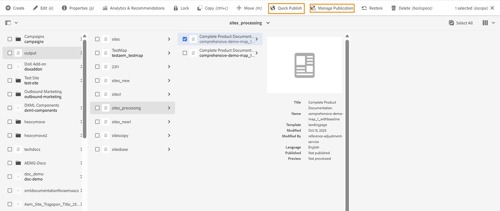

# Manage replication of DITA source assets

When the output generated from DITA content are published using **Quick Publish** or **Manage Publication** on some publish environment, AEM also attempts to publish the associated DITA source assets, such as DITA maps and, in some cases, DITA topics. This occurs because AEM treats DITA assets as dependencies of the generated Sites pages. 

 {width="350"}

To prevent the unintended replication of DITA content to the publish environment and to avoid performance issues, Administrators must explicitly manage DITA asset replication through the Configuration Manager. This configuration enables administrators to control the replication of supported DITA asset types, including DITA maps, DITA topics, XML files, and Markdown (.md) files. 

To configure the DITA assets replication feature, view  [Configure DITA assets replication for Cloud Service](../cs-install-guide/configure-dita-assets-replication.md) or [Configure DITA assets replication for On-Premise](../install-guide/configure-dita-asset-replication.md) depending on the setup you are using
