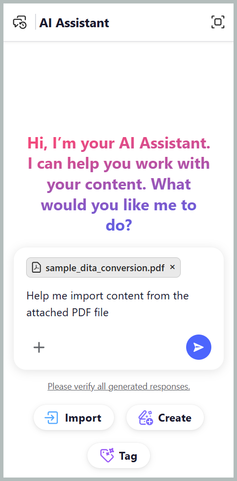

# Import content with AI Assistant

The **Import** skill in AI Assistant's Agentic mode helps you convert existing PDF, Word, or Markdown files into structured DITA topics and a corresponding map. It simplifies content migration to Adobe Experience Manager Guides by reducing the manual effort required to recreate and organize content.

## Import a file

You can import files from your device or content repository, specify the heading level that defines the start of a new topic, and choose the destination folder for the imported content. To import a file, follow these steps:

1. Log in to Experience Manager Guides.
1. On the Home page, select **AI Assistant** from the Navigation bar. Ensure that the AI Assistant in Agentic mode is enabled by your Administrator. 
1. Select **Import** from the AI Assistant panel. You can also use other prompts like `Convert this docx to DITA topics.` for a Word file or `Convert this markdown into DITA topics.` for a Markdown file.

   The starter prompt `Help me import content from the attached PDF file` appears in the prompt box.

1. Attach the file to your prompt using any of the following methods: 

   - **Using shortcut**: Type `/` in the Prompt field, then choose **Add repository reference** to choose the file from the Repository (or **Add files from device** to upload the file from your computer).

   - **Using `Attach files or add context (+)*` icon**: Adds files from your local system to provide the content for importing. 

   - **Drag and drop**: Drag and drop the file you want to import from the system directly into the prompt space.

      

1. Select **Send**.

   AI Assistant analyzes the file and lists each step it completes.

1. Select and confirm the folder where you want to save the imported topics.   

   

1. Choose the heading level that becomes a topic. For example H2 as shown in the screenshot.

   

1. Select **Confirm**.

   AI Assistant starts converting the file.

1. Select **Preview** to review the generated topics and the map.

   Check that each topic starts at the heading you expected and that the map order matches the original file. You can also check the Source code of the data imported using the Source tab. 

   

1. Select one of the following:

   - **Accept** to save all topics and the map to the folder you confirmed
   - **Reject** to discard the import without saving anything   

   The topics and the map are now available in your repository.

      

After the conversion finishes, AI Assistant opens a preview of the generated topics and map. You can navigate to the corresponding map and topics directly from the AI Assistant dialog.

## Import pasted content as topics

Pasting content from a web page, Word, Google Docs, or a wiki lets you import without saving a file first. Formatted content keeps its headings, lists, and tables.

To import pasted content:

1. Log in to Experience Manager Guides.
1. On the Home page, select **AI Assistant** from the Navigation bar. Ensure that the AI Assistant in Agentic mode is enabled by your Administrator. 

2. Copy the content from the web page, Word, Google Docs, or wiki.

3. Paste the content into the prompt box.

   Formatted content over 2,000 characters is attached as Markdown, so its structure carries over.

      

4. Enter a prompt that names what you want.

   For example, enter `Import the pasted page into DITA.` or `Turn the pasted content into DITA topics and a map.`

5. Select **Send**.

AI Assistant prompts you to select the heading level for splitting content into topics and specify the destination folder. The remaining steps are the same as importing an attached file, including reviewing and confirming the import plan to generate DITA topics and a map.

