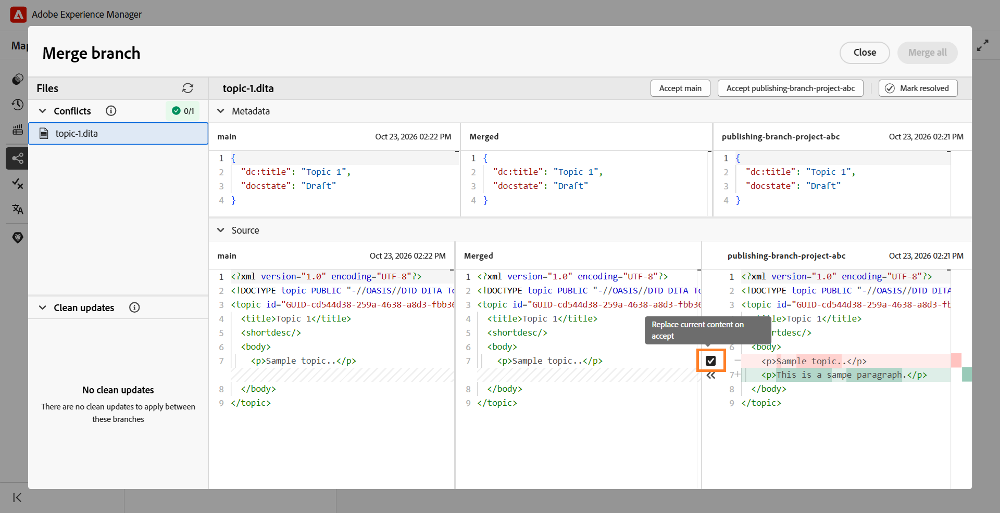

# Merge a branch into main

In Experience Manager Guides, you can merge changes from a branch of a DITA map into the `main` branch. Merging allows you to incorporate completed documentation updates into `main` without manually copying the changes into `main`.

For example, consider a DITA map named `install-the-lift.ditamap` with a branch named `Release 2`. Authors can update the installation instructions in this branch while the existing documentation remains unchanged in `main`.

Once the updates are ready, authors can merge the changes from `Release 2` into `main`.

## Understand branch merging

Merging brings changes from a selected branch of a DITA map into the `main` branch.

- **Source branch:** The branch containing the changes you want to merge.
- **Target branch:** The default branch (`main`) into which the changes are merged.

If the same part of a topic/map has been modified in both branches, merge conflicts may occur and require resolution.

## Merge a branch

You can merge changes from a selected branch of a DITA map into `main`.

To merge a branch, perform the following steps:

1. Open the required DITA map in the Map console.
2. Navigate to the **Branches** tab.
3. Locate the branch containing the changes you want to merge.
4. Open the branch's **Options** menu and select **Merge into main**.

    

   A merge request is created for the selected branch. It allows you to review the changes and resolve any conflicts before merging them into `main`.
  
    

5. Select the merge request. 

    The merge request opens in the **Merge branch** view. Review the changes and resolve any conflicts, if required.
6. Complete the merge.

   Review the changes and resolve any conflicts, if required. For more information, view [Resolve merge conflicts](#resolve-merge-conflicts).

   Once all conflicts are resolved, select **Merge all** to merge the changes into `main`.

   The changes are merged into the `main` branch.

## Resolve merge conflicts

A merge conflict occurs when the same content has been modified in both `main` and the branch being merged. You must resolve all conflicts before merging the changes into `main`.

When you open a merge request, the following sections are displayed in the **Merge branch** view:

- **Conflicts:** Lists files that require conflict resolution.
- **Clean updates:** Lists files that can be merged without resolving conflicts.

For files with conflicts, a three-way merge view is displayed.

The **Merge branch** view contains the following panes:

- **Left pane (main):** Displays the content from the default branch (`main`).
- **Middle pane (Merged):** Displays the merged content, where you can accept changes from either branch or edit the content directly.
- **Right pane (selected branch):** Displays the content from the branch being merged into `main`.

The differences are highlighted in the left and right panes based on the content in the **Merged** pane:

- **Red (-):** Indicates content present in the **Merged** pane that differs from the content in the corresponding left or right pane.
- **Green (+):** Indicates content present in the left or right pane that is not included in the **Merged** pane.

Initially, the **Merged** pane contains the same content as `main`, so differences are highlighted in the right pane. Once you accept changes from the selected branch, the left pane shows differences compared with the updated **Merged** pane.

Perform the following steps to resolve merge conflicts:

1. In the **Conflicts** section, select the file containing conflicts. 

    >[!NOTE]
    >
    > Files listed under **Clean updates** contain changes made only in the selected branch and hence do not require conflict resolution.

2. Review the differences highlighted in the three-way merge view and resolve the conflicts using the merge controls.

   The checkbox next to a conflict in the right pane determines how the selected branch content is added to the **Merged** pane:

   - **Selected (default):** Replaces the matching content in the **Merged** pane with the selected branch content.
   - **Cleared:** Adds the selected branch content alongside the existing content in the **Merged** pane without replacing it.

   You can resolve conflicts using the following options:

   - If you want to use the changes from the selected branch, keep the checkbox for the conflict selected and then select the corresponding left-pointing arrow control (`<<<`). The selected branch content replaces the conflicting content in the **Merged** pane.

     

   - If you want to keep content from both branches, clear the checkbox for the conflict and then select the left-pointing arrow control (`<<<`). This adds the selected branch content to the **Merged** pane without replacing the content already present in that pane.

     

   - If you've accepted changes from the selected branch and want to restore the corresponding content from `main`, select the right-pointing arrow control (`>>>`) in the left pane. This replaces the selected content in the **Merged** pane with the version from `main`.

   >[!TIP]
   >
   > Hover over an arrow control to view how accepting the selected change will affect the **Merged** pane.

3. After reviewing the merged content, you can also use one of the following options to accept the entire content from either branch:

   - **Accept main:** Replaces the content in the **Merged** pane for the selected file with the version from `main`.
   - **Accept [branch name]:** Replaces the content in the **Merged** pane for the selected file with the version from the selected branch.

   >[!NOTE]
   >
   > Selecting either option replaces the entire content in the **Merged pane** for the selected file, including any changes you made manually while resolving conflicts.

   Alternatively, you can review or edit the content directly in the **Merged** pane and select **Mark resolved** to retain the merged content.

4. Review the final content in the **Merged** pane and select **Mark resolved** to mark the file as resolved.

5. Repeat the steps for all files listed under **Conflicts**.

   Once all conflicts are resolved, the **Merge all** option becomes available.

6. Select **Merge all** to merge the resolved files and the clean updates into `main`.

    >[!NOTE]
    > 
    > The **Merge all** option remains disabled until all conflicts are resolved.

   The resolved changes are merged into `main`. A completed merge cannot be undone. However, you can create a new merge request to merge subsequent changes into main.

## Manage a merge request

You can manage existing merge requests using the context menu.

To manage a merge request, open its context menu and select one of the following options:

- **Preview:** Shows the changes in the merge request without merging them.
- **View log:** View the log associated with the merge request.
- **Delete:** Delete the merge request. The branch and its changes are not affected.
- **View report:** View the merge report after the branch has been merged into `main`.