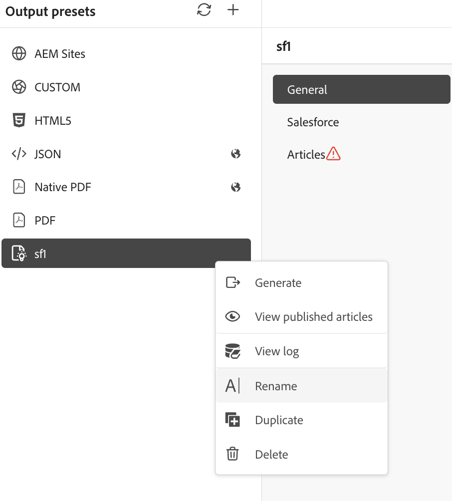

# Generate Knowledge Base output {#id218CL05J0M1}

Adobe Experience Manager Guides comes with an article-based publishing feature that allows the users to publish one or more Knowledge Base articles simultaneously.

This engine also comes with an OOTB content template, built on top of Adobe Experience Manager core components, that lets users create a knowledge-based repository of the technical content. This template can be customized to suit the needs of the customers.This engine allows the users to build the DITA map in an additive fashion and publish topics as and when they are ready. 

If you have updated the content only for a few topics in your DITA map, you do not always have to publish the entire map. You can select and publish only the updated topics.

For article-based publishing, you need to create the output preset for your Knowledge Base DITA map. Your map must include the topics that you want to publish. You can also apply conditions and specify the AEM Sites details for the output preset. Then, you can generate output using the **Generate output** feature.

Perform the following steps to generate article-based ouput:

1. [Create the Knowledge Base preset](./generate-output-knowledge-base.md) for article-based output.
1. Navigate to the **Articles** tab and select the topics for which you wish to generate the output.

    

    >[!NOTE]
    >
    > When publishing to Salesforce, a warning icon appears next to the **Articles** tab if no topics are selected for publishing. The warning icon disappears once you select one or more topics.
1. Select **Generate output** at the top to generate the output.
1. In the **Confirm files for publishing** prompt, select the files you want to publish and confirm by selecting **Publish**.

    

    You will view the status of the output generation process. The **Topics** column lists the topics for which output is being generated while the **Status** column displays the publishing status of each topic.

    

    To view the output, close the **Output Generated** dialog box and select **View output** on the preset page. 

    >[!NOTE]
    >
    > You can also Rename, Duplicate, or Delete an existing output preset from the Options menu.

## Enhanced Salesforce publishing using backend processing

Starting with the 2026.11.0 release of Experience Manager Guides as Cloud Service, an enhanced Salesforce publishing experience is available. It uses backend processing to support larger publishing jobs, improve security, and address issues with the existing publishing process.

>[!NOTE]
>
> The enhanced Salesforce publishing experience is disabled by default. To enable it, contact the Adobe Customer Success team.

When you publish articles to Salesforce using the enhanced experience, the following additional capabilities are available:

- **Warning for unselected topics**: A warning indicator appears in the **Articles** tab of the Salesforce Knowledge Base output preset when no topics are selected for publishing. The warning disappears once you select one or more topics.

  
- **Article-level publishing status**: After output generation, the publishing status of each article, such as Success or Failed, along with its topic or file name is displayed in the **Saleforce Publish Results** dialog.

  

- **Publishing logs**: Use the **View log** option in the Salesforce Knowledge base output preset to review publishing logs and troubleshoot errors or warnings.

  

  The logs also provide a summary of the publishing results.

  
- **Output history**: View the output history of publishing tasks from the **Map console** or the **Assets UI**.

  For more information about managing publishing tasks, view [Manage output generation process](./generate-output-manage-process.md).

  
- **Optimized asset publishing:** When publishing topics to Salesforce, Experience Manager Guides checks whether the referenced assets, such as multimedia and other non-DITA files, have been modified since their last publication. Only modified assets are published again, while unchanged assets are skipped. This reduces redundant asset updates and improves publishing efficiency.

### PKCE and refresh token-based authentication

The enhanced Salesforce publishing experience also supports refresh token-based authentication, reducing the need to repeatedly log in to Salesforce from Experience Manager Guides when access tokens expire.

>[!NOTE]
>
> Refresh token support is disabled by default. To enable it, contact the Adobe Customer Success team.

To use this capability, ensure that **Perform requests at any time (refresh_token, offline_access)** is included in the selected OAuth scopes and **Require Proof Key for Code Exchange (PKCE) Extension for Supported Authorization Flows** is enabled in your Salesforce connected app.

Enabling refresh token support in Experience Manager Guides automatically enables PKCE support. However, the corresponding setting must also be enabled in Salesforce for authentication to work successfully.

**Parent topic:**[Work with the Editor](web-editor.md)
